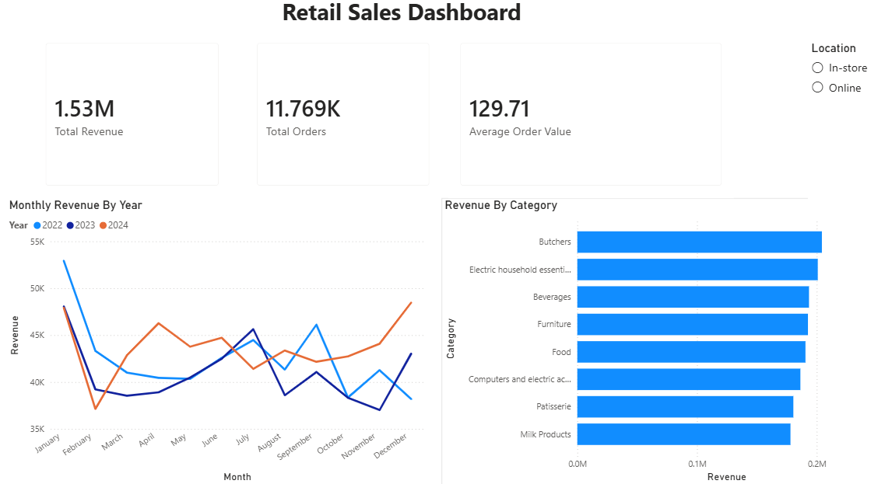

# Retail Sales Dashboard — Power BI

A one-page, interactive Power BI dashboard built on a retail sales dataset that I previously cleaned in Python. The goal was to turn clean data into a quick, readable view of revenue, order volume, category performance, and sales trends.

> **Data source:** the cleaned output of my Python project: [Retail-Sales-Cleaning-Analysis](https://github.com/abdulrehman-DA/Retail-Sales-Cleaning-Analysis)

## Dashboard Preview

*(Add your dashboard screenshot to the repo as `dashboard_screenshot.png`, or change the file name above to match.)*

## What the Dashboard Shows

| Visual | What it answers |
|---|---|
| **Total Revenue** (card) | How much was sold overall |
| **Total Orders** (card) | How many orders were placed (distinct transaction count) |
| **Average Order Value** (card) | Average spend per transaction, built with a DAX measure |
| **Revenue by Category** (bar chart) | Which product categories bring in the most sales |
| **Sales Trend by Month and Year** (line chart) | How sales move through the year, with one line per year to compare seasonal patterns |
| **Location slicer** | Filters the whole dashboard by Online vs. In-store |

## Skills Demonstrated

- Importing and preparing a CSV in Power BI (data types, date fields)
- Summary cards and aggregations (Sum, Distinct Count)
- Writing a basic **DAX measure**: `Average Order Value = AVERAGE(Total Spent)`
- Bar and line charts, including splitting a line chart by year to compare seasonality
- Slicers and cross-filtering, so one click updates every visual on the page

## Notes

- 2025 data is excluded because the dataset only contains partial January data for that year, which would make the trend look like a decline when it isn't one. The reasoning is documented in the Python project.
- This is a deliberately simple, single-page dashboard that shows the fundamentals. I'm continuing to build my Power BI skills and plan to add more pages and measures over time.

## Files

- `retail_sales_dashboard.pbix` — the Power BI file (open with Power BI Desktop)
- `dashboard_screenshot.png` — preview image of the dashboard

## Tools Used

Power BI Desktop, DAX
